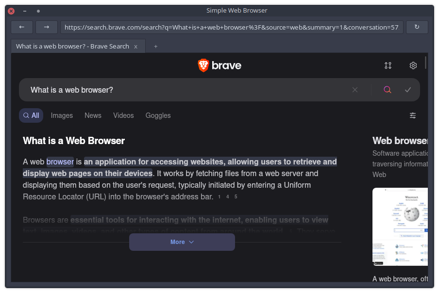

# SWB (Simple Web Browser)

NOTE: THIS PROJECT IS NOT COMPLETE!!!!

Feature progress:

- [x] Tabs
- [x] Plugin Loading
- [x] Navigation and rendering
- [x] Adblock
- [x] Downloads
- [x] Navigation + Tabs (Link Following)
- [ ] Bookmark Storage
- [ ] Password Storage
- [ ] PKGBUILD

## Description

Pronounced as "swub" /swʌb/

A Web Browser should be a Web Browser and nothing more, and it should integrate well with your system.

Goals:

1. Only the folowing features implemented (what I consider necessary):
   - Modern rendering of pages (Doesn't have to be perfect, but must be usable)
   - Navigation: Search, Direct Link, Forwards, Backwards
   - Tabs
   - Downloads
   - Adblock
   - Bookmarks: Creation, Deletion, Folder Sorting
   - Password Storage
2. Plugin system that can greatly modify the browser (including UI), acheived by making *everything* a plugin, even things like the back and forward buttons.
3. Decent performance, i.e. built on top 3 engines: Blink, Gecko, or WebKit (WebKit in this case)
4. Well, *except*, not built on Chromium/Blink, since that has a monopoly
5. No added privacy concerns out of the box (no telemetry, ads, or data collection)

Officially supported platform will be Arch Linux, but binaries will be built for other Linux, and package maintainers are welcome to build their own.

## Build

Dependencies:

- curl
- \*nix (Arch is the supported platform)
- gcc
- gtk3
- libnotify
- make
- pkg-config
- webkit2gtk
- json-c (for adblock plugin)
- swift 6 w/ embedded swift support (for adblock plugin)

`make RELEASE=1`

## Architecture

Outside of some core framework glue, everything in swb is designed to be a plugin.

Plugins can respond to a variety of events that happen like "when a page loads."

However, plugins can also choose to have a widget, most often a button, in the bar

The default plugins:

- SWBRefreshBtn - refreshes the current page of the active tab
- SWBBackBtn and SWBFwdBtn buttons - navigate active tab back and forth
- SWBNavBar - allow going to a specific page or searching (via Brave Search)
   + Navbar is intentionally simplistic, so this is the first you might consider swapping out
   + Many features lacking from modern navbars like searching multiple engines or getting suggestions or searching bookmarks
   + However, you can change the search engine by adding a search query to `~/.config/swb/.search_engine`
      * A query is a URL with the search text replaced with '%s'. The default is: `https://search.brave.com/search?q=%s`
      * To switch to say, Google, you'd do: `https://www.google.com/search?q=%s`
- SWBAdBlock - apply a filter list before rendering a page to try to stop annoying and malicious ads
   + Simple AdBlock based on filtering rules
   + Filter lists:
      * Ka-Block!:`https://github.com/dgraham/Ka-Block`
      * AdGuard Lists (from Safari iOS Extensions)
         - YouTube Filter
      * AdGuard Lists (Primary) converted into WebKit format
         - BaseFilter
         - Annoyances
